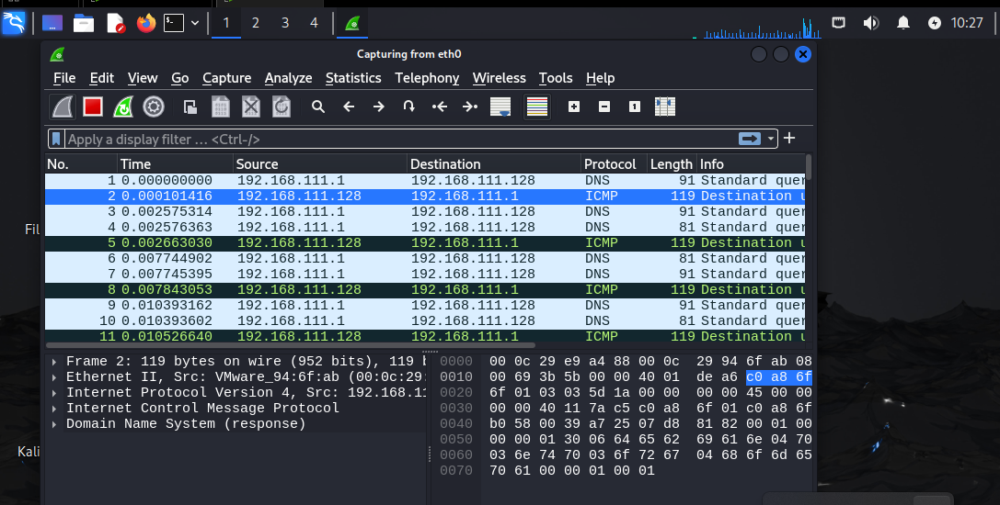
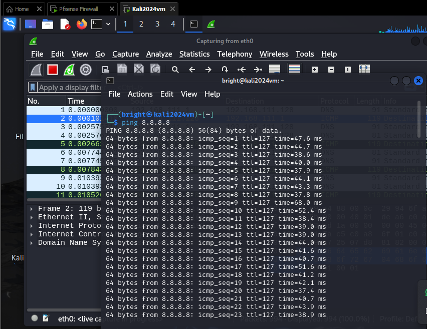
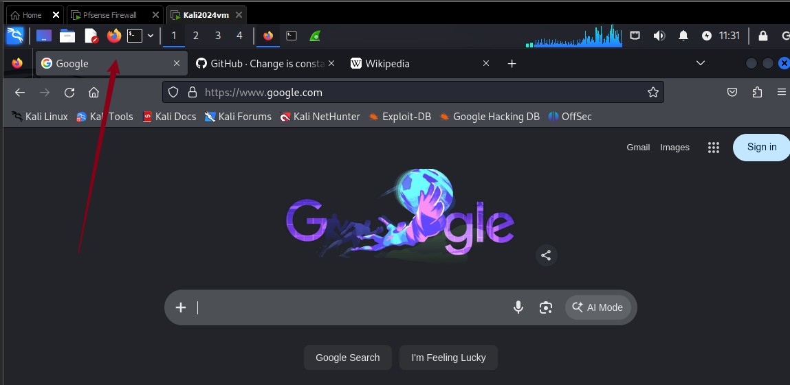
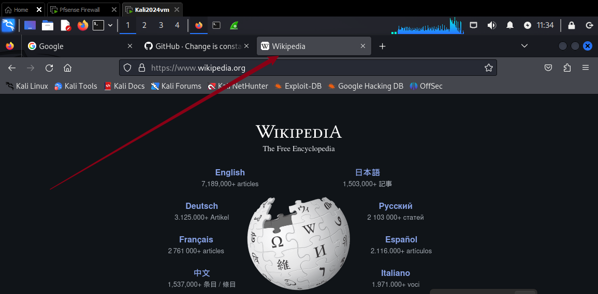
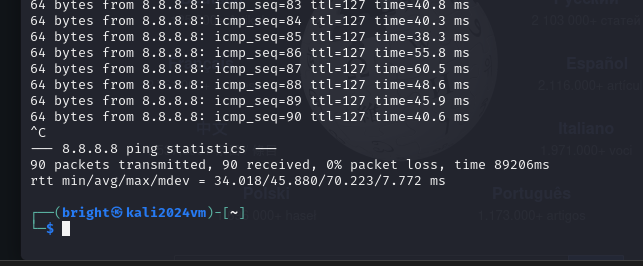
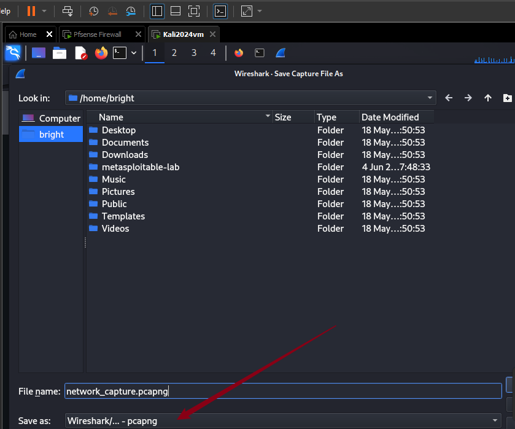
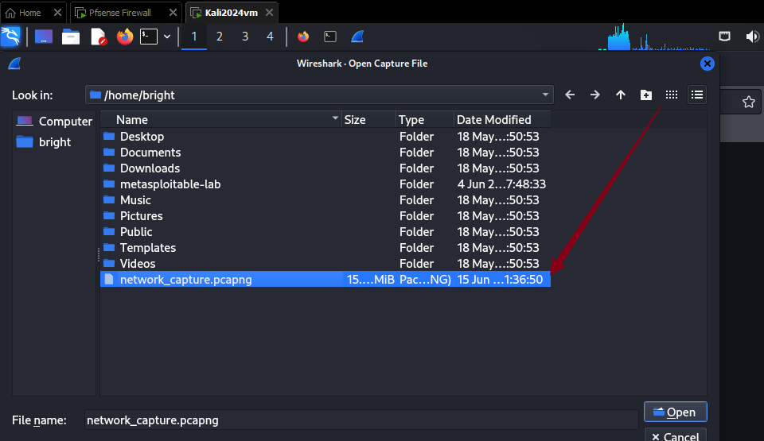
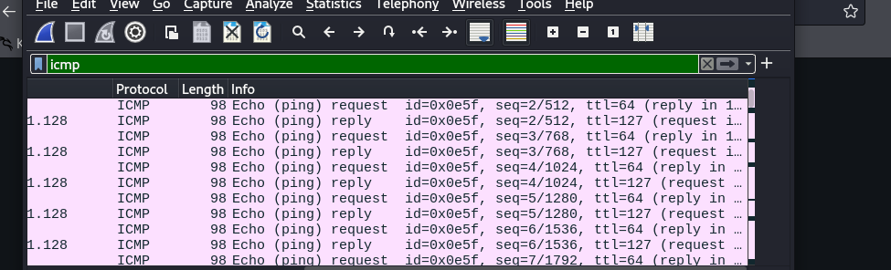
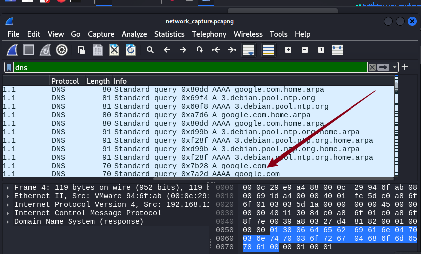
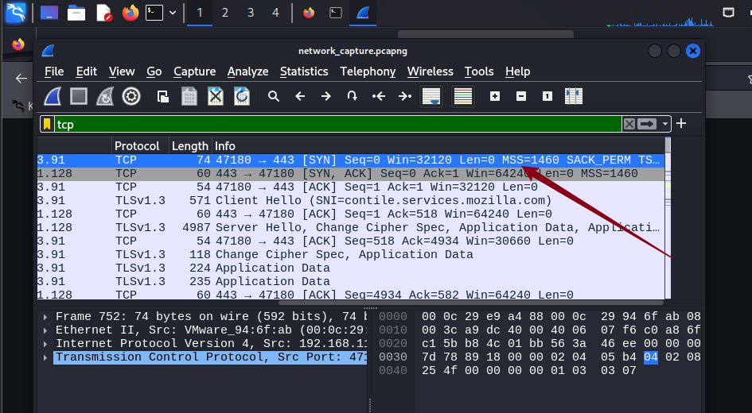

# Network Traffic Analysis Using Wireshark.

## Project Overview: 
This project demonstrates live network traffic capture and protocol analysis using Wireshark.

 We capture real-time packets while performing common network activities (ICMP pings and web browsing), then analyze ICMP, DNS, and TCP traffic in detail.
Objectives:

Capture live network traffic on the eth0 interface
Generate traffic using ping and web browsing
Apply display filters to isolate specific protocols
Analyze ICMP, DNS, and TCP packet structures

## Tools Used:

Wireshark (latest version)
Firefox Browser
Linux Terminal (ping command)

## Step-by-Step Procedure:

# Phase 1: Traffic Capture.

## 1. Start Capturing Packets:

Open Wireshark.

In the network interfaces list, locate eth0 (your active Ethernet/Wi-Fi interface).

Double-click on eth0 to begin capturing packets immediately.
Wireshark starts displaying packets in real time.

Alternative: Select eth0 and click the blue shark fin icon (▶).

## 2. Generate ICMP Traffic

Open a terminal window.
Run the following command:Bashping 8.8.8.8This sends continuous ICMP Echo Requests to Google’s public DNS server.

## 3. Generate Web Traffic (DNS + TCP + HTTP/HTTPS)
Screenshots:

Open Firefox.

Visit the following websites one by one:

- https://google.com

- https://github.com

- https://wikipedia.org

This generates DNS queries, TCP connections, and HTTPS traffic.

## 4. Stop the Ping

Return to the terminal running the ping command.
Press Ctrl + C to stop the ping.

## 5. Save the Capture

In Wireshark, go to File → Save As.

Save the file as network_analysis.pcapng (or .pcap).

This allows us to reopen and analyze the capture later.

# Phase 2: ICMP Analysis:

Steps i took:

Open the saved capture file in Wireshark.

In the display filter bar (top green bar), type:wiresharkicmp
Press Enter.

Look for packets with Protocol = ICMP.

Key Observations:

- Echo (ping) Request (Type = 8, Code = 0)

- Echo (ping) Reply (Type = 0, Code = 0)

- Source IP = your local machine
Destination IP = 8.8.8.8

- ICMP Sequence numbers match requests with replies
Time-to-Live (TTL) and round-trip time can be observed.

# Phase 3: DNS Analysis.

Steps:

Clear the previous filter (click the red "X" or delete text).

Apply the DNS filter:wiresharkdns
Expand the DNS packet details.

Key Observations:

- Queries (Standard query) for domains like google.com, github.com, wikipedia.org.

- Responses containing resolved IPv4 (A) and IPv6 (AAAA) records.

- DNS uses UDP port 53 by default.

- Transaction IDs help match queries with responses.

# Phase 4: TCP Analysis.

Steps:

- Clear the filter.

- Apply a TCP filter: wiresharktcp Or more specific: wireshark tcp.port == 443    # HTTPS traffic.

Key Observations:

- TCP 3-Way Handshake:
SYN → SYN-ACK → ACK

- TCP Flags (SYN, ACK, FIN, RST)

- Sequence numbers and Acknowledgment numbers.

- Source and Destination ports (e.g., 443 for HTTPS).

- TLS Handshake (for encrypted HTTPS connections)

# 🎯 Conclusion:

This project successfully demonstrated the fundamentals of network traffic analysis using Wireshark.
 By capturing live packets during ICMP pings and web browsing sessions, we were able to isolate and examine key protocols — ICMP, DNS, and TCP — using appropriate display filters.

Through this hands-on exercise, we gained practical insights into how modern networks operate: from simple echo requests and domain name resolutions to the reliable connection-oriented communication provided by TCP.

The ability to capture, filter, and interpret network traffic is an essential skill for network administrators, cybersecurity professionals, and anyone interested in understanding how data flows across the internet.

## Final and key takeaways:

Wireshark is a powerful open-source tool for deep packet inspection.

Proper use of display filters significantly improves analysis efficiency.

Real-world traffic consists of multiple layered protocols working together.

This project serves as a solid foundation for more advanced topics such as TLS decryption, anomaly detection, and network troubleshooting.

My Learning Outcomes:

- Understood how to capture and save network traffic with Wireshark.

- Learned to use display filters (icmp, dns, tcp)
Analyzed real-world behavior of ICMP, DNS, and TCP protocols.

- Gained practical experience in network troubleshooting basics.